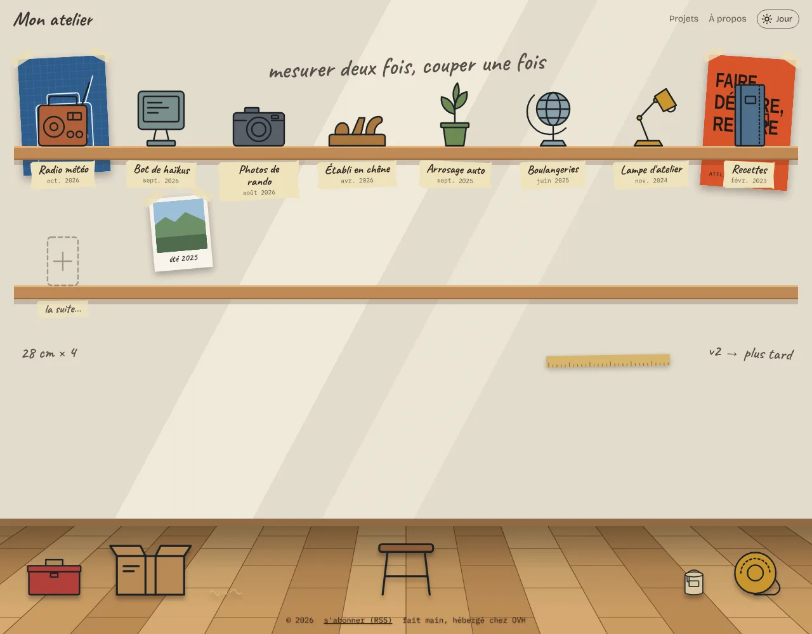
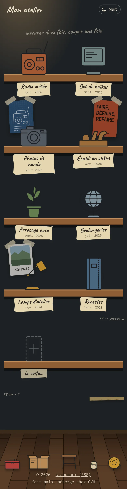

# L'atelier (The workshop)

*[Version française](README.md)*

A personal website template for sharing your projects. The home page is a workshop wall: each project is an object sitting on a shelf, from the most recently updated to the oldest. Clicking an object opens the project's page.

<p align="center">
  
  &nbsp;
  
</p>

It runs on OVH's free web hosting (PHP, no database, 100 MB), or on any Apache host with PHP 7.4 or later. All content lives in folders and plain text files that are easy to edit by hand. There is no database, no build step and nothing to install.

> The site's interface and the configuration keywords are in French (`titre`, `objet`, `couleur`…). This page gives the English equivalent of each one.

## Getting started

1. On GitHub, click **Use this template → Create a new repository** (or **Code → Download ZIP**).
2. Fill in `site.txt`: site name (`nom`), your name (`auteur`), optional e-mail, and the site URL (`adresse`).
3. Rewrite `a-propos.md` (the "About" page) or delete it.
4. Delete the example projects in `projets/` (keep `_modele/`) and add your own.
5. Adjust the wall (`mur/mur.txt`) and the floor (`sol/sol.txt`) if you like.
6. Deploy (see below and [docs/deploiement-ovh.md](docs/deploiement-ovh.md), in French).

## Adding a project

1. Copy `projets/_modele/` and rename it, e.g. `projets/my-project/` (letters without accents, digits and dashes only).
2. Fill in `projet.txt`:

   ```
   titre:   Weather radio                      # title
   objet:   radio                              # drawing from dessins/
   couleur: #b0603a                            # fill colour
   maj:     2026-10-28                         # last update: sets the order
   resume:  An old radio that reads the weather forecast at 7 am.
   ```

3. Write the project page, in one of three ways:
   - **`page.md`**: Markdown. Images from the folder are inserted with ``;
   - **`index.html`**: a free-form HTML page with its own style and JavaScript;
   - **`lien: https://...`** in `projet.txt`: the object links straight to another site.

   With none of these, the site shows the summary and the folder's images as a gallery.

To hide a project without deleting it, add `cache: oui`. Folders starting with `_` are never shown.

## Objects

`objet: radio` uses `dessins/radio.svg`. Included drawings: `appareil-photo` (camera), `carnet` (notebook), `ecran` (screen), `globe`, `lampe` (lamp), `plante` (plant), `rabot` (plane) and `radio`.

- **Add a drawing to the library**: drop `dessins/my-drawing.svg`, then write `objet: my-drawing`.
- **A project-specific object**: drop `objet.svg` or `objet.png` in the project folder.

For an SVG to match the workshop style, draw it as line art with no fixed colours, in a `viewBox="0 0 100 110"`, touching the bottom of the frame. The fill comes from `couleur:` and the stroke follows day/night mode. Shapes that must stay unfilled take `fill="none"`. A PNG keeps its own colours.

## The wall

`mur/mur.txt` lists what hangs behind the shelves: writing (`texte`), posters (`affiche`), framed photos (`photo`) and plain images (`image`). Images go in `mur/`.

```
texte: measure twice, cut once
  taille: grande   cote: centre   etagere: 1

affiche: plan-radio.svg
  taille: moyenne  cote: gauche   rotation: -3
```

No positions are given: each item is attached to a shelf and placed according to screen width. Options: `taille` (size: `petite`, `moyenne`, `grande`), `cote` (side: `gauche`, `droite`, `centre`), `etagere` (shelf number, or `fin` for the last one), `rotation` (degrees), `telephone: non` (hide on small screens), `legende` (photo caption). Items never overlap; order sets priority. Options on one line are separated by at least two spaces. Full details are at the top of `mur/mur.txt`.

## The floor

`sol/sol.txt` lists objects lying on the floor at the bottom of each page: drawings from `dessins/sol/` (`caisse`, `carton`, `touret`, `tabouret`, `pot-de-peinture`, `copeaux`) or images from `sol/`. The last ones disappear first on small screens.

## Everything else

- `site.txt`: site name, author and e-mail for the footer, search-engine description, site URL.
- `a-propos.md`: the "About" page. If the file is missing, the menu link disappears.
- `flux.php`: the projects' RSS feed. A project appears (again) whenever its `maj` date changes.
- `.htaccess`: server settings: custom 404 page, no directory listings, compression, caching, and `robots.txt` / `sitemap.xml` generated from your projects. The HTTPS redirect is ready but commented out.
- Day and night mode follow the visitor's device; the toggle button remembers their choice.

## Running locally

With PHP installed, at the repository root:

```
php -S localhost:8000
```

then open http://localhost:8000.

## Deployment

On every push to `main`, a GitHub Action uploads the site to OVH over FTP (`.github/workflows/deploiement.yml`). Create these secrets under *Settings → Secrets and variables → Actions*:

| Secret | Value |
| --- | --- |
| `FTP_SERVEUR` | FTP server, e.g. `ftp.cluster0XX.hosting.ovh.net` |
| `FTP_UTILISATEUR` | FTP login |
| `FTP_MOT_DE_PASSE` | FTP password |
| `FTP_DOSSIER` | optional: remote folder, `./www/` by default |

Without these secrets the action does nothing. You can also upload the files by hand into `www/` with an FTP client (don't forget the hidden `.htaccess` files). The step-by-step guide (in French) is in [docs/deploiement-ovh.md](docs/deploiement-ovh.md).

## Contributing

Suggestions and fixes are welcome via issues or pull requests. Please keep the spirit of the project: no database, no build step, plain text files editable by hand, and a site that fits comfortably in 100 MB.

## License

Code and drawings are released under the [MIT License](LICENSE). Parsedown, bundled in `inc/`, is also MIT-licensed ([inc/Parsedown-LICENSE.txt](inc/Parsedown-LICENSE.txt)).
