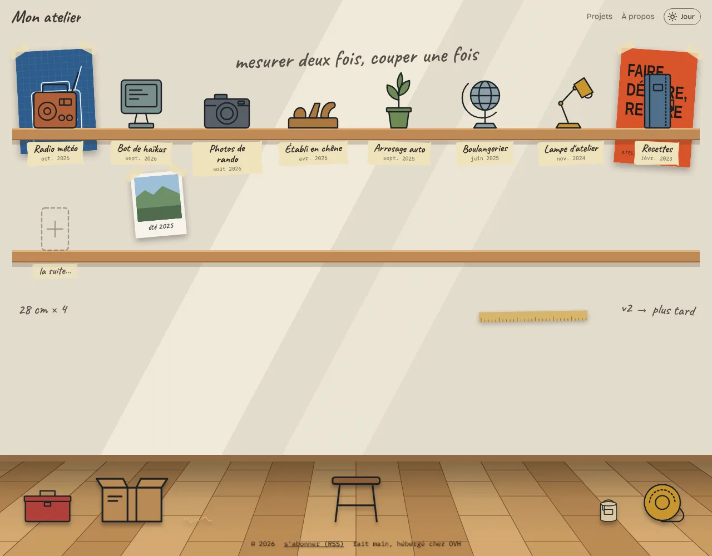
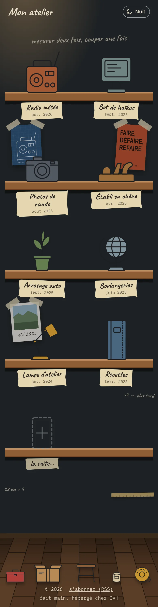

# L'atelier

Un site perso pour partager ses projets. La page d'accueil est un mur d'atelier : chaque projet est un objet posé sur une étagère, du plus récemment mis à jour au plus ancien. Un clic sur l'objet ouvre la page du projet.

<p align="center">
  
  &nbsp;
  
</p>
<p align="center"><em>L'accueil avec le contenu d'exemple : de jour sur ordinateur, de nuit sur téléphone.</em></p>

Le site tourne sur l'hébergement gratuit d'OVH : PHP, pas de base de données. Tout le contenu est rangé dans des dossiers et des fichiers texte faciles à modifier à la main.

## Ajouter un projet

1. Copie le dossier `projets/_modele/` et renomme-le, par exemple `projets/mon-projet/`. Utilise seulement des lettres sans accent, des chiffres et des tirets.
2. Remplis `projet.txt` :

   ```
   titre:   Radio météo
   objet:   radio
   couleur: #b0603a
   maj:     2026-10-28
   resume:  Une vieille radio qui annonce la météo du jour à 7 h.
   ```

   `maj` est la date de dernière mise à jour. C'est elle qui décide de l'ordre sur les étagères.
3. Écris la page du projet. Tu as trois possibilités :
   - **`page.md`** : du Markdown. Les images du dossier s'insèrent avec `` ;
   - **`index.html`** : une page HTML entièrement libre, avec son propre style et son JavaScript ;
   - **`lien: https://...`** dans la fiche : l'objet mène directement à un autre site.

   Sans aucune des trois, le site affiche le résumé et les images du dossier en galerie.
4. Envoie les modifications (voir [Déploiement](#déploiement)).

Pour retirer un projet sans le supprimer, ajoute `cache: oui` dans sa fiche. Les dossiers qui commencent par `_` ne sont jamais affichés.

## Les objets

`objet: radio` correspond au dessin `dessins/radio.svg`. Les dessins fournis sont `appareil-photo`, `carnet`, `ecran`, `globe`, `lampe`, `plante`, `rabot` et `radio`.

- **Ajouter un dessin à la bibliothèque** : dépose un fichier `dessins/mon-dessin.svg`, puis écris `objet: mon-dessin`.
- **Un objet propre à un projet** : dépose `objet.svg` ou `objet.png` dans le dossier du projet. Il remplace le dessin de la bibliothèque.

Pour qu'un SVG prenne le style de l'atelier, dessine-le au trait, sans couleur imposée, dans un `viewBox="0 0 100 110"`, le bas du dessin touchant le bas du cadre. La couleur de remplissage vient de `couleur:` dans la fiche, et le trait suit le mode jour ou nuit. Les formes qui ne doivent pas être remplies prennent `fill="none"`. Un PNG garde ses propres couleurs.

## Le mur

`mur/mur.txt` liste ce qui est accroché derrière les étagères : des écritures, des affiches, des photos et des images. Les images vont dans le dossier `mur/`.

```
texte: mesurer deux fois, couper une fois
  taille: grande   cote: centre   etagere: 1

affiche: plan-radio.svg
  taille: moyenne  cote: gauche   rotation: -3

photo: vacances.jpg
  taille: petite   legende: été 2025
```

On ne donne pas de position : le site accroche chaque élément à une étagère et le place selon la largeur de l'écran.

- Sans `etagere`, les éléments se répartissent sur toute la hauteur du mur. `etagere: 2` en épingle un sur une étagère précise, `etagere: fin` le met sous la dernière.
- `cote` vaut `gauche`, `droite` ou `centre`. Si la place est prise, l'élément glisse vers l'autre côté, puis change d'étagère, puis rétrécit.
- Deux éléments ne se chevauchent jamais. S'il n'y a vraiment plus de place, l'élément n'est pas affiché sur cet écran.
- L'ordre compte : le premier élément est placé en premier et passe devant les autres.
- `telephone: non` masque un élément sur les petits écrans.

Les options d'une même ligne sont séparées par au moins deux espaces. Le détail complet est en tête de `mur/mur.txt`.

## Le sol

`sol/sol.txt` liste les objets qui traînent par terre, en bas de chaque page. Ce sont des dessins de `dessins/sol/` (`caisse`, `carton`, `touret`, `tabouret`, `pot-de-peinture`, `copeaux`) ou des images du dossier `sol/`. Comme sur le mur, l'ordre fixe la priorité : sur un petit écran, les derniers de la liste disparaissent.

## Le reste

- `site.txt` : le nom du site, ton nom et ton e-mail pour le pied de page, la description pour les moteurs de recherche.
- `a-propos.md` : la page « À propos ». Si le fichier n'existe pas, le lien disparaît du menu.
- `flux.php` : le flux RSS des projets, signalé par le lien « s'abonner (RSS) » en bas de chaque page. Un projet y apparaît, ou y réapparaît, chaque fois que tu changes sa date `maj`. Les pages en Markdown y sont incluses en entier. Indique l'adresse du site dans `site.txt` (`adresse: https://...`) pour que les liens du flux soient exacts. Pour proposer un abonnement par e-mail, un service gratuit comme follow.it ou Feedrabbit peut lire ce flux et envoyer les nouveautés.
- Mode jour et mode nuit : le site suit le réglage de l'appareil du visiteur. Le bouton en haut à droite permet de changer, et ce choix est retenu.

## Tester sur son ordinateur

Avec PHP installé, à la racine du dépôt :

```
php -S localhost:8000
```

puis ouvre http://localhost:8000.

## Déploiement

À chaque modification de la branche `main`, une action GitHub envoie le site sur OVH par FTP (`.github/workflows/deploiement.yml`). Pour l'activer, crée ces secrets dans GitHub, sous *Settings → Secrets and variables → Actions* :

| Secret | Valeur |
| --- | --- |
| `FTP_SERVEUR` | le serveur FTP indiqué par OVH, par exemple `ftp.cluster0XX.hosting.ovh.net` |
| `FTP_UTILISATEUR` | l'identifiant FTP |
| `FTP_MOT_DE_PASSE` | le mot de passe FTP |
| `FTP_DOSSIER` | facultatif : le dossier distant, `./www/` par défaut |

Tant que ces secrets n'existent pas, l'action ne fait rien. Tu peux aussi envoyer le contenu du dépôt à la main avec un client FTP, dans le dossier `www/`.

## Organisation des fichiers

```
index.php          l'établi (page d'accueil)
projet.php         la page d'un projet (page.md, ou résumé et galerie)
apropos.php        la page « À propos » (a-propos.md)
flux.php           le flux RSS des projets
site.txt           les réglages généraux
projets/           un dossier par projet
dessins/           la bibliothèque d'objets ; dessins/sol/ pour le sol
mur/               mur.txt et les images accrochées au mur
sol/               sol.txt et les images posées par terre
assets/            la feuille de style et le script de placement
inc/               le code PHP commun, et Parsedown pour le Markdown (licence MIT)
docs/              les captures d'écran de ce README (non envoyées sur OVH)
```

Le site vide pèse moins de 200 Ko. Les 100 Mo d'OVH restent pour tes images et tes pages.
